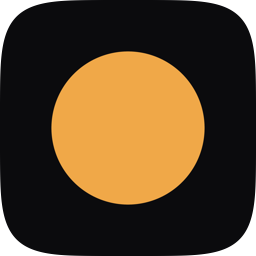

<p align="center">
  
</p>

<h1 align="center">Duskling</h1>

<p align="center">
  <strong>Free, private, open-source dark mode for Safari on iPhone and iPad.</strong><br>
  No account, no subscription, no tracking.
</p>

Install it, turn it on, and every site is dark. Duskling recolors a site's own colors instead of inverting the page, and
leaves sites that are already dark alone.

## Features

- Dark mode that is on by default for every site, and that you can pause globally or per site.
- Three themes: Dark (default), Midnight and Dim.
- Per site in the Safari popup: turn dark mode off, pick a theme, use or ignore the site's own dark theme, and dim images.
- Respects a site's own dark theme when it has one.
- Optional dimming of images.
- Report a broken site by email. Only the host name is included, and you review the draft before sending.
- Settings sync between the app and the Safari extension on your device, and between your devices through iCloud.

## Privacy

Duskling collects no data and has no server, analytics or account. Its only network requests are fetches of stylesheets and
images that the page you are viewing already references, made on your device to recolor them. Details are in
[PRIVACY.md](PRIVACY.md).

## Build it yourself

You can build Duskling from source and install it on your own iPhone or iPad. You need a Mac, an Apple Account and a
USB cable or the same Wi-Fi network as the device. A paid Apple Developer Program membership is not required.

1. Install [Xcode 26](https://apps.apple.com/app/xcode/id497799835), then the command-line tools with
   [Homebrew](https://brew.sh):

   ```sh
   brew install node@24 pnpm xcodegen
   export PATH="$(brew --prefix node@24)/bin:$PATH"
   ```

2. Get the source and build the Safari extension:

   ```sh
   git clone https://github.com/hamzic/duskling.git
   cd duskling
   apple/scripts/build-extension.sh
   ```

3. Set up signing. In Xcode, open Settings › Accounts and add your Apple Account; this creates a free "Personal Team".
   Then create `apple/Config/Signing.local.xcconfig` (git-ignored) with your team ID and a bundle id of your own (bundle
   ids must be unique, so the project's own can't be used):

   ```
   DEVELOPMENT_TEAM = ABCDE12345
   CODE_SIGN_STYLE = Automatic
   APP_BUNDLE_ID = com.yourname.duskling
   APP_GROUP_ID = group.com.yourname.duskling
   DUSK_APP_ENTITLEMENTS = App/Dusk.personal.entitlements
   ```

   Your team ID is shown in Xcode under Signing & Capabilities once the project is open, or at
   [developer.apple.com/account](https://developer.apple.com/account) under Membership details. With a paid membership,
   leave out the `DUSK_APP_ENTITLEMENTS` line to keep iCloud sync between devices; a free Personal Team can't use it.

4. Generate the Xcode project and run it:

   ```sh
   cd apple
   xcodegen generate
   open Dusk.xcodeproj
   ```

   Select the **Dusk** scheme and your device, then press Run. The first time, the device asks you to turn on Developer
   Mode in Settings › Privacy & Security and to restart
   ([Apple's guide](https://developer.apple.com/documentation/xcode/enabling-developer-mode-on-a-device)). If iOS says the
   developer isn't trusted, trust your Apple Account in Settings › General › VPN & Device Management.

5. Turn the extension on: Settings › Apps › Safari › Extensions › Duskling, switch it on and allow all websites.

Apps signed by a free Personal Team stop opening when their provisioning profile expires, about a week after the build.
Run it from Xcode again to renew it; your settings are kept.

## Development

Requirements: Node 24 and pnpm 10. The iOS app needs Xcode 26 on macOS.

Extension (TypeScript):

```sh
cd extension
pnpm install --frozen-lockfile
pnpm run typecheck && pnpm run lint && pnpm test
pnpm run build      # writes extension/dist/
pnpm run size       # checks the size budgets
```

iOS app and Safari extension (macOS, Xcode 26, [XcodeGen](https://github.com/yonaskolb/XcodeGen)):

```sh
apple/scripts/build-extension.sh          # builds the extension and copies it into apple/Extension/Resources/
cd apple && xcodegen generate             # generates apple/Dusk.xcodeproj (git-ignored)
open Dusk.xcodeproj                       # then run the app scheme on an iPhone or iPad simulator
```

The Simulator needs no Apple account: the project builds unsigned, and the tests sign ad hoc
(`CODE_SIGNING_ALLOWED=YES CODE_SIGN_IDENTITY=-`, see [apple.yml](.github/workflows/apple.yml)). To run on a device,
see [Build it yourself](#build-it-yourself).
Swift package tests (no Xcode project needed): `swift test --package-path apple/Packages/SettingsKit`.

## Internal names

Targets and files still use the codename from development: `Dusk.xcodeproj`, the `Dusk` scheme, `DuskExtension`, and
`data-dusk` attributes in pages.

## Contributing

See [CONTRIBUTING.md](CONTRIBUTING.md). To report a security problem, see [SECURITY.md](SECURITY.md).

## License

MIT. See [LICENSE](LICENSE) and [THIRD_PARTY_NOTICES.md](THIRD_PARTY_NOTICES.md).

Safari, iPhone, iPad, iCloud and App Store are trademarks of Apple Inc. Duskling is not affiliated with Apple or Dark
Reader.
